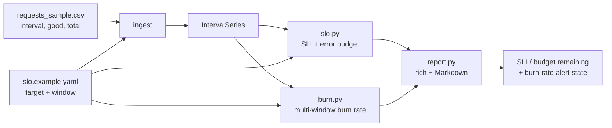

# slo-error-budget-tracker

> Compute SLO compliance, error-budget burn, and multi-window burn-rate alerts from request-count time series — offline, with correct SRE math.


## Overview

A **Service Level Objective (SLO)** is a target for how reliable a service should be — say, "99.9% of checkout requests succeed over a rolling 30 days." The gap between that target and 100% is your **error budget**: the amount of failure you are *allowed* before the objective is missed. Spending it is fine; that budget is what buys you releases, migrations, and risk.

The problem is *timing*. A month-end "we missed the SLO" report tells you nothing you can act on. What you want is to know, **right now**, whether you are burning the budget fast enough to care. That is **burn-rate alerting**: page when a short, intense window of errors would exhaust the whole month's budget in hours — but stay quiet during a healthy trickle that the budget easily absorbs.

`slo-error-budget-tracker` takes an SLO definition plus good/total request counts per interval and computes the achieved SLI, budget consumed/remaining, and a **multi-window, multi-burn-rate** alert ladder following the Google SRE workbook. It renders a rich terminal report and an equivalent Markdown report, and runs fully offline on bundled sample data.

## Architecture



## Concepts

- **SLI (Service Level Indicator)** — the measured quality of service. Here it is request-based: `good / total`.
- **SLO (Service Level Objective)** — the target the SLI must meet over a window, e.g. `99.9%` over `30d`.
- **Error budget** — the failures you are allowed: `(1 - target) * total`. At 99.9% over 864,000 requests, that is `0.001 * 864,000 = 864` allowed failures. Consuming more misses the SLO.
- **Burn rate** — how fast the budget is being spent: `observed_error_rate / (1 - target)`. A burn rate of **1** spends the budget exactly over the full window; **14.4** spends it in 1/14.4 of the window (~2% of a 30-day budget in one hour).
- **Multi-window alerting** — a rule fires only when **both** a long window (significance) and a short window (fast reset) exceed the threshold, which stops the alert flapping after an incident ends.

Thresholds and window pairs follow the *Alerting on SLOs* chapter of the [Google SRE Workbook](https://sre.google/workbook/alerting-on-slos/). This is a portfolio/demo implementation of those concepts, not an affiliated product.

## Features

- Request-based SLI and error-budget math (consumed, remaining, and percentages).
- Multi-window, multi-burn-rate alert ladder: `14.4x / 6x / 3x / 1x` (fully configurable via YAML).
- Automatic interval detection from timestamps; long windows gracefully fall back to available data.
- Rich terminal report **and** Markdown report from the same computed numbers (they never drift).
- CLI exits non-zero when a `page`-severity alert fires — drop-in for CI or a cron check.
- Loud input validation (`good > total`, missing columns, bad targets) and zero-traffic guards.
- Fully offline; deterministic bundled sample with a healthy stretch and a burn incident.

## Tech stack

- **Python 3.11**
- **pandas** — CSV ingest and windowed aggregation
- **PyYAML** — SLO / burn-window definitions
- **click** — CLI
- **rich** — terminal reporting
- **pytest** — offline test suite

## Getting started

```bash
git clone https://github.com/matthews-wong/slo-error-budget-tracker.git
cd slo-error-budget-tracker

python -m venv .venv
source .venv/bin/activate        # Windows: .venv\Scripts\activate

pip install -e .
slo-tracker report               # uses the bundled sample data + SLO
```

## Usage

Run against the bundled sample (a 3-day, 5-minute-interval series that is healthy overall but ends in a one-hour error burst):

```bash
slo-tracker report --data data/requests_sample.csv --slo slo.example.yaml
```

Real output on the sample data:

```text
+---------------------- SLO / Error Budget -----------------------+
| SLO 'checkout-api-availability' target 99.9000% over 30d -> MET |
+-----------------------------------------------------------------+
                   Error Budget
+-------------------------------------------------+
| Metric                          |         Value |
|---------------------------------+---------------|
| Achieved SLI                    |      99.9512% |
| Target                          |      99.9000% |
| Total requests                  |       864,000 |
| Good / Bad                      | 863,578 / 422 |
| Error budget (allowed failures) |           864 |
| Budget consumed                 |           422 |
| Budget remaining                |           442 |
| Budget remaining %              |        51.16% |
+-------------------------------------------------+
                       Burn-Rate Alerts (multi-window)
+----------------------------------------------------------------------------+
| Rule          | Severity |        Long |        Short | Threshold | State  |
|---------------+----------+-------------+--------------+-----------+--------|
| fast-critical | page     | 25.00x (1h) |  25.00x (5m) |     14.4x | FIRING |
| fast-high     | page     |  4.28x (6h) | 25.00x (30m) |        6x |   ok   |
| slow-medium   | ticket   |  1.18x (1d) |  12.58x (2h) |        3x |   ok   |
| slow-low      | ticket   |  0.49x (3d) |   4.28x (6h) |        1x |   ok   |
+----------------------------------------------------------------------------+
+----------------------------------------------------+
| ALERT: 'fast-critical' firing (page) at 25.0x burn |
+----------------------------------------------------+
```

This is exactly the scenario burn-rate alerting is designed for: the **30-day SLO is still MET** with **51% of the error budget remaining**, yet the final hour is burning at **25x** — so `fast-critical` pages *now*, long before the budget would actually run out. The slower windows correctly stay quiet, because a single bad hour does not (yet) breach their multi-hour long windows.

For a copy-pasteable report, use Markdown:

```bash
slo-tracker report --format markdown
```

## Project structure

```
slo-error-budget-tracker/
├── slobudget/
│   ├── __init__.py         # package exports + version
│   ├── models.py           # SLO, IntervalSeries, BudgetStatus, BurnWindow/Result
│   ├── slo.py              # SLI + error-budget math
│   ├── burn.py             # burn rate + multi-window alert logic
│   ├── ingest.py           # load counts (CSV) and SLOs (YAML)
│   ├── report.py           # rich + Markdown renderers
│   └── cli.py              # `slo-tracker` console entry point
├── data/
│   └── requests_sample.csv # interval,good,total — healthy stretch + burn incident
├── slo.example.yaml        # target + window + burn-window ladder
├── tests/                  # pytest, fully offline
├── pyproject.toml
├── requirements.txt
├── .github/workflows/ci.yml
├── LICENSE
└── README.md
```

## Testing

```bash
pip install -e ".[dev]"
pytest -q
```

The suite is offline and deterministic. It checks that budget math is correct on hand-verified inputs, that the burn-rate definition holds (a 1.44% error rate at a 99.9% target is exactly 14.4x), and that a high-error window trips the `fast-critical` alert while healthy data does not.

## Roadmap

- **Prometheus query source** — pull `good`/`total` from range queries instead of CSV.
- **Multiple SLOs** — evaluate a portfolio of objectives (availability, latency) in one run.
- **Latency SLIs** — threshold-based good-event counting for percentile objectives.
- **Alert routing** — emit Alertmanager / webhook payloads on a firing page.

## License

MIT — see [LICENSE](LICENSE). Copyright (c) 2026 Matthews Wong.

---

Part of my cloud & AI portfolio — see [github.com/matthews-wong](https://github.com/matthews-wong).
